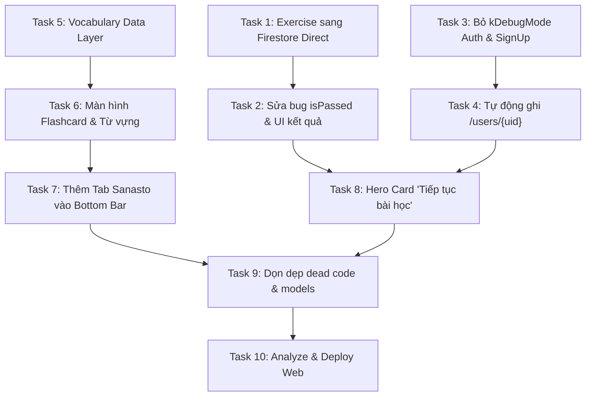

# Kế hoạch Triển khai Thực thi Opi Suomea (Implementation Plan)

> **Kế hoạch căn cứ:** Báo cáo kiểm toán [toan_bo_danh_gia_du_an.md](file:///C:/Users/UY/.gemini/antigravity-ide/brain/770bc56b-68fe-401c-9346-cc8bbe14a1d4/toan_bo_danh_gia_du_an.md)  
> **Mục tiêu cốt lõi:** Gỡ bỏ hoàn toàn điểm nghẽn Production (chuyển sang Serverless Firestore), sửa triệt để các bug nghiêm trọng của Bài tập & Auth, bổ sung Tab Từ Vựng Flashcard, và hoàn thiện vòng lặp học tập để sẵn sàng thử nghiệm / mở bán.  
> **Kiến trúc:** Flutter 3.x, Riverpod 2.x, Cloud Firestore Direct Client SDK (Serverless), Firebase Auth, Firebase Storage.

---

## TỔNG QUAN CÁC GIAI ĐOẠN TRIỂN KHAI (ROADMAP PHASES)

```
+-----------------------------------------------------------------------------------+
| Phase 1: Unblock Production Exercise Engine (Serverless Direct Firestore)        |
|   - Task 1: Chuyển đổi ExerciseRepository sang Cloud Firestore trực tiếp          |
|   - Task 2: Sửa bug isPassed/passed & bổ sung nút Làm lại bài / Xem đáp án        |
+-----------------------------------------------------------------------------------+
| Phase 2: Mở khóa Authentication & Tự động Tạo Hồ sơ Học viên                      |
|   - Task 3: Bỏ kDebugMode, hỗ trợ Email Register & Google Sign-in Native         |
|   - Task 4: Tự động khởi tạo document /users/{uid} trên Firestore                 |
+-----------------------------------------------------------------------------------+
| Phase 3: Hoàn thiện Vòng lặp Học tập Cốt lõi (Tab Từ vựng & Flashcards)           |
|   - Task 5: Xây dựng VocabularyRepository & Riverpod Provider cho Mobile         |
|   - Task 6: Xây dựng Màn hình Flashcard lật thẻ 3D & Audio phát âm                |
|   - Task 7: Mở rộng Bottom Navigation Bar (MainShell) từ 2 lên 3-4 tabs           |
+-----------------------------------------------------------------------------------+
| Phase 4: UX Polish, Hero Action & Dọn dẹp Technical Debt                          |
|   - Task 8: Hero Card "Tiếp tục bài học dở dang" ở trang chủ                      |
|   - Task 9: Dọn dẹp domain models trùng lặp & mã chết (Dead Code)                |
|   - Task 10: Kiểm thử toàn diện & Build Verification (Flutter Web)                |
+-----------------------------------------------------------------------------------+
```

---

## CHI TIẾT TỪNG NHIỆM VỤ THỰC THI (ATOMIC TASKS)

### Phase 1: Unblock Production Exercise Engine (Serverless Direct Firestore)

#### Task 1: Chuyển đổi `ExerciseRepository` sang Cloud Firestore trực tiếp
* **Mục tiêu:** Loại bỏ sự phụ thuộc vào NestJS API (`http://localhost:3000`), giúp tính năng bài tập chạy 100% độc lập trên cả Production Web (`htpfe.web.app`) lẫn thiết bị di động Native.
* **Files bị tác động:**
  * [mobile_app/lib/features/exercise/data/exercise_repository.dart](file:///c:/Users/UY/works/hoctiengphan/mobile_app/lib/features/exercise/data/exercise_repository.dart)
  * [mobile_app/lib/features/exercise/presentation/exercise_notifier.dart](file:///c:/Users/UY/works/hoctiengphan/mobile_app/lib/features/exercise/presentation/exercise_notifier.dart)
* **Các bước thực hiện:**
  1. Xóa `Dio` khỏi `ExerciseRepository`, inject `FirebaseFirestore.instance` và `FirebaseAuth.instance`.
  2. Triển khai `getExerciseById(String id)`: Đọc trực tiếp từ `FirebaseFirestore.instance.collection('exercises').doc(id).get()`. Parse bằng `Exercise.fromJson(doc.data()!)`.
  3. Triển khai `submitAnswer`:
     * Chấm điểm trực tiếp tại client dựa vào dữ liệu câu hỏi (`correctIndex` hoặc `correctText`).
     * Tính toán `score`, `total`, `percentage`, `passed` (>= 70%).
     * Nếu `passed == true` và có `planId` cùng `activityId`, cập nhật trực tiếp tiến độ vào Firestore:
       ```dart
       await _db.collection('user_progress').doc(uid).collection('plans').doc(planId).set({
         'activities': {
           activityId: {
             'status': 'done',
             'completedAt': FieldValue.serverTimestamp(),
           }
         },
         'updatedAt': FieldValue.serverTimestamp(),
       }, SetOptions(merge: true));
       ```
  4. Cập nhật `exerciseRepositoryProvider` trong Riverpod không còn lắng nghe `apiClientProvider`.

#### Task 2: Sửa bug hiển thị kết quả bài tập (`passed` vs `isPassed`) & Bổ sung nút Retry
* **Mục tiêu:** Đảm bảo khi học viên vượt qua bài tập (>= 70%), hiệu ứng Confetti sẽ nổ, hiển thị huy hiệu thành công và cho phép làm lại bài hoặc quay về lộ trình.
* **Files bị tác động:**
  * [mobile_app/lib/features/exercise/presentation/exercise_screen.dart](file:///c:/Users/UY/works/hoctiengphan/mobile_app/lib/features/exercise/presentation/exercise_screen.dart)
* **Các bước thực hiện:**
  1. Tại line 301 của `exercise_screen.dart`, sửa:
     ```dart
     final isPassed = result['passed'] == true || result['isPassed'] == true;
     ```
  2. Bổ sung nút "Làm lại bài này" (Uudelleen / Try Again) trong widget `_ExerciseResultView`, khi bấm sẽ gọi `notifier.reset()`.
  3. Thêm bảng Accordion hiển thị chi tiết các câu làm sai và giải thích (`feedback`) để học viên học lại từ lỗi sai.

---

### Phase 2: Mở khóa Authentication & Tự động Tạo Hồ sơ Học viên

#### Task 3: Bỏ điều kiện `kDebugMode` trong Form Đăng nhập & Mở rộng Đăng ký
* **Mục tiêu:** Cho phép người dùng thực tế đăng nhập bằng Email/Password trên bản Release production, và hỗ trợ Đăng ký tài khoản mới.
* **Files bị tác động:**
  * [mobile_app/lib/features/auth/presentation/auth_screen.dart](file:///c:/Users/UY/works/hoctiengphan/mobile_app/lib/features/auth/presentation/auth_screen.dart)
  * [mobile_app/lib/features/auth/data/firebase_auth_repository.dart](file:///c:/Users/UY/works/hoctiengphan/mobile_app/lib/features/auth/data/firebase_auth_repository.dart)
* **Các bước thực hiện:**
  1. Trong `auth_screen.dart`, loại bỏ bao bọc `if (kDebugMode)` quanh Form Email/Mật khẩu (lines 204–330).
  2. Thêm state toggle `bool _isSignUp = false` để chuyển đổi giữa chế độ "Đăng nhập" và "Đăng ký tài khoản mới".
  3. Thêm phương thức `createUserWithEmailAndPassword` vào `FirebaseAuthRepository`.
  4. Cải tiến `signInWithGoogle`: Kiểm tra `kIsWeb ? _auth.signInWithPopup(provider) : _auth.signInWithProvider(provider)` để tránh crash khi chạy native app.

#### Task 4: Tự động khởi tạo Document `/users/{uid}` khi đăng nhập thành công
* **Mục tiêu:** Khi học viên đăng nhập (qua Google hoặc Email), hệ thống tự động ghi bản ghi vào collection `users` nếu chưa tồn tại, giúp Admin CMS quản lý được học viên.
* **Files bị tác động:**
  * [mobile_app/lib/features/auth/data/firebase_auth_repository.dart](file:///c:/Users/UY/works/hoctiengphan/mobile_app/lib/features/auth/data/firebase_auth_repository.dart)
* **Các bước thực hiện:**
  1. Viết helper function `syncUserProfile(User user)`:
     ```dart
     final userRef = FirebaseFirestore.instance.collection('users').doc(user.uid);
     final snap = await userRef.get();
     if (!snap.exists) {
       await userRef.set({
         'id': user.uid,
         'email': user.email ?? '',
         'displayName': user.displayName ?? (user.email?.split('@').first ?? 'Opiskelija'),
         'photoUrl': user.photoURL,
         'role': 'user',
         'createdAt': FieldValue.serverTimestamp(),
         'lastLoginAt': FieldValue.serverTimestamp(),
       });
     } else {
       await userRef.update({'lastLoginAt': FieldValue.serverTimestamp()});
     }
     ```
  2. Gọi `syncUserProfile` sau khi đăng nhập Email, đăng nhập Google, hoặc trong `authStateChanges` listener.

---

### Phase 3: Hoàn thiện Vòng lặp Học tập Cốt lõi (Tab Từ vựng & Flashcards)

#### Task 5: Xây dựng Vocabulary Data Layer & Riverpod Providers trên Mobile
* **Mục tiêu:** Đọc kho từ vựng từ collection `vocabularies` trên Cloud Firestore phục vụ cho học viên.
* **Files tạo mới:**
  * `mobile_app/lib/features/vocabulary/data/vocabulary_repository.dart`
  * `mobile_app/lib/features/vocabulary/presentation/vocabulary_notifier.dart`
* **Các bước thực hiện:**
  1. Tạo `VocabularyRepository` với các hàm:
     * `watchVocabularies({String? chapter})`: Lấy stream từ vựng sắp xếp theo từ tiếng Phần Lan.
     * `getVocabulariesByChapter(String chapter)`: Lấy từ vựng theo bài (VD: "Kappale 1", "SM1-K1").
     * `getCategories()`: Lấy danh sách phân loại (Chào hỏi, Số đếm, Động từ...).
  2. Tạo `vocabularyListProvider` và `chapterFilterProvider` quản lý state trong Riverpod.

#### Task 6: Xây dựng Màn hình Flashcard lật thẻ 3D & Audio phát âm
* **Mục tiêu:** Cung cấp trải nghiệm học từ vựng trực quan: Lật thẻ xem nghĩa tiếng Việt / ví dụ và nghe phát âm chuẩn.
* **Files tạo mới:**
  * `mobile_app/lib/features/vocabulary/presentation/vocabulary_screen.dart`
  * `mobile_app/lib/features/vocabulary/presentation/widgets/flashcard_view.dart`
* **Các bước thực hiện:**
  1. Tạo `FlashcardView` với hiệu ứng lật thẻ 3D mượt mà (`Transform` với góc xoay Y) khi chạm.
     * Mặt trước: Từ tiếng Phần Lan (cỡ chữ to, đậm), loại từ (danh từ, động từ...), nút loa phát âm Audio.
     * Mặt sau: Nghĩa tiếng Việt, tiếng Anh, câu ví dụ minh họa.
  2. Tích hợp `AudioPlayer`: Phát `audioUrl` từ Firebase Storage (hoặc `flutter_tts` tiếng Phần Lan làm phương án dự phòng).
  3. Cung cấp 2 chế độ xem: Chế độ Luyện Flashcard (lướt từng từ kèm nút "Đã thuộc" / "Cần ôn lại") và Chế độ Danh sách tra cứu nhanh (Dictionary list).

#### Task 7: Mở rộng Bottom Navigation Bar từ 2 lên 3-4 tabs
* **Mục tiêu:** Đưa tính năng Từ vựng (Sanasto) ra vị trí trang trọng ngay trên thanh điều hướng dưới đáy màn hình.
* **Files bị tác động:**
  * [mobile_app/lib/core/common/widgets/main_shell.dart](file:///c:/Users/UY/works/hoctiengphan/mobile_app/lib/core/common/widgets/main_shell.dart)
  * [mobile_app/lib/core/navigation/app_router.dart](file:///c:/Users/UY/works/hoctiengphan/mobile_app/lib/core/navigation/app_router.dart)
* **Các bước thực hiện:**
  1. Trong `main_shell.dart`, bổ sung tab:
     * `(path: '/vocabulary', icon: Icons.style_outlined, activeIcon: Icons.style, labelFi: 'Sanasto')`
  2. Trong `app_router.dart`, đăng ký route `/vocabulary` vào bên trong `ShellRoute`:
     ```dart
     GoRoute(
       path: '/vocabulary',
       builder: (context, state) => const VocabularyScreen(),
     ),
     ```

---

### Phase 4: UX Polish, Hero Action & Dọn dẹp Technical Debt

#### Task 8: Hero Card "Tiếp tục bài học dở dang" ở trang chủ
* **Mục tiêu:** Giải quyết lỗi UX nghiêm trọng: Học viên mở app không cần nhớ mình đang học đến đâu, chỉ cần 1 chạm để vào ngay bài học gần nhất.
* **Files bị tác động:**
  * [mobile_app/lib/features/study_plan/presentation/study_plan_list_screen.dart](file:///c:/Users/UY/works/hoctiengphan/mobile_app/lib/features/study_plan/presentation/study_plan_list_screen.dart)
* **Các bước thực hiện:**
  1. Đọc tiến độ học viên từ `studyPlanRepositoryProvider.getUserProgress(planId)`.
  2. Xác định bài học/activity đầu tiên chưa hoàn thành (hoặc bài học hoàn thành gần nhất).
  3. Hiển thị banner lớn ở đầu trang: "Tiếp tục học • Jatka opiskelua: [Tên bài]" kèm nút bấm nhảy thẳng vào `LessonScreen` hoặc `ExerciseScreen`.

#### Task 9: Dọn dẹp Domain Models trùng lặp & Mã chết (Dead Code)
* **Mục tiêu:** Giảm dung lượng source, tránh bug import sai model và tinh gọn codebase.
* **Files bị tác động:**
  * Xóa thư mục legacy không dùng: `mobile_app/lib/features/roadmap/` (đã được thay thế hoàn toàn bởi `study_plan`).
  * Xóa widget không được liên kết: `mobile_app/lib/features/exercise/presentation/exercise_completion_screen.dart` và `exercise_result_provider.dart`.
  * Hợp nhất model từ vựng trong `admin_tool`: xóa `features/vocabulary_editor`, quy về `features/vocabulary`.

#### Task 10: Kiểm thử Toàn diện & Xác thực Build (Flutter Web & Rules)
* **Mục tiêu:** Đảm bảo toàn bộ ứng dụng sạch lint, không có lỗi runtime và sẵn sàng deploy.
* **Lệnh kiểm thử:**
  1. Phân tích mã nguồn: `cd mobile_app && flutter analyze` (yêu cầu: 0 errors).
  2. Build thử nghiệm Web: `flutter build web --release`.
  3. Deploy Hosting & Rules lên Firebase Production:
     ```bash
     firebase deploy --only hosting:app,firestore:rules
     ```
     *(Tuân thủ tuyệt đối Hiến pháp dự án: Không chạy bất kỳ script đồng bộ dữ liệu seed/emulator lên production).*

---

## MA TRẬN PHỤ THUỘC & THỨ TỰ THỰC HIỆN (DEPENDENCY GRAPH)



---

## TIÊU CHÍ HOÀN THÀNH (DEFINITION OF DONE)

1. [x] **Không còn lỗi kết nối Localhost:** Khi mở app trên bản deploy Web `https://htpfe.web.app`, vào bài tập nộp thử sẽ không có bất kỳ request nào gửi tới `localhost:3000`.
2. [x] **Học viên đạt điểm cao nhận đúng feedback:** Khi làm đúng bài tập, màn hình hiện hiệu ứng pháo hoa Confetti và icon tích xanh cùng số điểm chuẩn xác.
3. [x] **Đăng nhập mượt mà trên môi trường thật:** Mở trang đăng nhập bản Release thấy đầy đủ ô nhập Email/Mật khẩu; người dùng mới có thể đăng ký và xuất hiện trong CMS Admin.
4. [x] **Có Tab Từ vựng độc lập:** Thanh điều hướng có nút "Sanasto", cho phép lật thẻ Flashcard nghe phát âm từng từ tiếng Phần Lan.
5. [x] **Bảo vệ tuyệt đối dữ liệu Production:** Không có bất kỳ dữ liệu mẫu từ emulator nào bị đồng bộ đè lên database production trong toàn bộ quá trình thực thi.
